  

<code>FIELD NOTE</code> &nbsp;·&nbsp; You're looking at a core sample. The newest work sits on top, the oldest is bedrock, and the fossils are projects that survived. Read it top to bottom, the way a geologist would.

 

### ⛏&nbsp; Specimen catalogue

| Nº | Specimen | Field description |
|:--:|:--|:--|
| `Nº 01` | [**context-meter**](https://github.com/nocashflow/context-meter) | See your Claude Code context, plan limits and cost as a band above the prompt or a side panel. |
| `Nº 02` | [**next-big-thing**](https://github.com/nocashflow) | Not started yet. The README is incredible though. |

 

  

### ◉&nbsp; Signal the surface team

 

<b>Lab results</b> — core samples sent off for analysis

 

  
  

Survey ends here. Everything below this line is unexplored.

